# XM6 Audio

**Native Windows Bluetooth audio, with capability-aware codec negotiation and a standard headphone endpoint.**

[](https://github.com/TruthNian/xm6-audio/actions/workflows/ci.yml)
[](LICENSE)
[](docs/ROADMAP.md)

English · [简体中文](README.zh-CN.md)

XM6 Audio adds an A2DP profile driver and a WaveRT render endpoint while Windows continues to own the Bluetooth radio, pairing, volume UI and AVRCP media-control stack. The WH-1000XM6 is the initial hardware acceptance target.

> **Development status:** the native drivers, service and codec checks build in CI. Microsoft kernel signing and native headset acceptance are still pending. CI artifacts are unsigned development candidates, not installable releases for a normally protected Windows system.

The [controlled developer trial](docs/HARDWARE-BRINGUP.md) established native playback and controls on 0.3.44, with reported YouTube audio stutter. Version 0.3.50 was activated without a computer restart and fixed the independently reproduced offline false-Connected path: Windows' actual display model finally remained Disconnected with the headset unavailable. Both loaded driver images and the running service were verified. **Connected per-device disconnect/reconnect and Chrome stability still require acceptance.**

The current activated version is **0.3.56**, with both actual drivers and the running service verified against the signed local package, without a computer restart. It carries session stop through signalling/media OPEN and protocol-send requests, including the gap after one-shot cancellation but before submission. Pending I/O still reaches terminal completion before its storage is released. All 26 local checks and [source CI](https://github.com/TruthNian/xm6-audio/actions/runs/43003121997) pass. Kernel bus ABI 6 is unchanged. Earlier incoming-channel recovery and PCM optimizations are retained. No universal shutdown deadline or measured playback improvement is claimed. See the [lifecycle review](docs/LIFECYCLE-REVIEW.md), [event-chain review](docs/EVENT-CHAIN-REVIEW.md), [performance review](docs/PERFORMANCE-REVIEW.md) and [codec review](docs/CODEC-REVIEW.md). **Do not load candidate 0.3.5**; its descriptor ABI error caused a developer-machine bugcheck and is corrected in 0.3.6.

For a paired, disconnected headset, the expected English label is **Paired**. `Disconnected(3)` is an internal Windows model enum; the installed Windows resources for both corresponding disconnected Bluetooth labels contain `Paired`. Settled model/AEP/container state and resource text have been verified independently; actual rendered Settings text/buttons remain an acceptance item.

The latest offline radio-cycle trace still includes roughly one second of transient Connected before the model settles to the state corresponding to Paired. The retained Windows inbox trace shows a similar transient interval. This alone does not identify a custom-driver fault; rendered text/buttons and the connected lifecycle remain unaccepted. See the [runtime record](docs/HARDWARE-BRINGUP.md).

**[Architecture](docs/ARCHITECTURE.md) · [Build from source](BUILDING.md) · [Signing status](docs/SIGNING.md) · [Roadmap](docs/ROADMAP.md)**

For connection-label problems, the [read-only command-line report](docs/DIAGNOSTICS.md) compares Windows radio, AEP, device-container and native-session state without operating the headset or changing settings. It is a diagnostic aid, not a reconnect fix or hardware acceptance.

## What the project implements

- A **standard Windows headphone endpoint** for applications using Windows Audio/WASAPI.
- **LDAC, AAC and SBC** negotiation from the intersection of local encoders, headset capabilities and per-device preferences.
- **Integer 16/24/32-bit and float32 PCM**, with container width and valid precision tracked separately, including 24-in-32.
- Sample-rate following for formats the peer supports, with explicit fixed-format profiles available for diagnostics.
- Device-interface notifications, buffered Bluetooth connection events, disconnected endpoint state and cleanup of stale PCM during reconnection.
- A codec service **installed by the driver INF and started by a Windows device-interface trigger**, with binaries loaded from Driver Store.

Native playback, manual play/pause/previous/next, wearing-detection pause/resume and bidirectional headset/Windows master volume have been confirmed in the controlled developer trial. Per-device disconnect and existing-client recovery remain unaccepted. See the hardware record for acceptance limits.

## Audio path

```mermaid
flowchart LR
    Apps["Music, video and system audio"] --> WinAudio["Windows Audio / WASAPI"]
    WinAudio --> Endpoint["WaveRT headphone endpoint"]
    Endpoint --> Codec["Codec service<br/>LDAC · AAC · SBC"]
    Codec --> Profile["KMDF A2DP profile"]
    Profile --> WindowsBT["Windows BTHPORT / BTHUSB"]
    WindowsBT --> Headset["Paired headphones"]
    Headset <--> AVRCP["Windows AVRCP"]
    AVRCP <--> Media["System media controls"]
```



The profile binds to the selected headset's A2DP Audio Sink service. Radio ownership and other Bluetooth profiles remain with Windows. The audio path uses the native endpoint's PCM buffer; it does not capture a player's output or loop back a different system endpoint.

See [component boundaries and lifecycle](docs/ARCHITECTURE.md).

## Format and quality policy

| Layer | Policy |
|---|---|
| Source files | The player/Windows decodes MP3, FLAC, ALAC, AAC, Opus, WAV and other formats it supports into PCM. File decoders do not belong in the Bluetooth driver. |
| Endpoint PCM | Integer 16/24/32 and float32; valid precision is distinct from container width. |
| Sample rate | Follow the actual Windows stream where supported. Shared-mode audio exposes the Windows mix format, not each file's original metadata. |
| LDAC quality | HQ by default: nominal 909 kbps at 44.1/88.2 kHz and 990 kbps at 48/96 kHz. ABR is off by default. |
| Precision boundary | Keep full integer32 PCM until conversion to the encoder's supported input precision. LDAC accepts at most 24 useful bits; a 32-bit container is not a claim of 32-bit Bluetooth transmission. |
| Negotiation | Prefer LDAC, then AAC/SBC. Report the actual codec and format. An explicitly fixed LDAC profile must not report a fallback as success. |

The legacy setting name `follow_source_rate` means **follow the endpoint PCM rate**. It does not inspect a player's file or streaming-quality label. Shared-mode clients are mixed to one Windows endpoint format before this driver receives PCM; selecting a 96 kHz file does not automatically change a 48 kHz shared mix. Exclusive playback can submit its supported format directly, while excluding other clients. Automatic per-file shared-mix selection is not implemented. See Microsoft's [device formats](https://learn.microsoft.com/en-us/windows/win32/coreaudio/device-formats) and [exclusive streams](https://learn.microsoft.com/en-us/windows/win32/coreaudio/exclusive-mode-streams).

The XM6 supports SBC/AAC/LDAC over Classic Audio and LC3 over LE Audio. LC3 is not part of this Windows 10 A2DP implementation. Sources: [Sony codec support](https://helpguide.sony.net/mdr/2984/v1/en/contents/TP1001856790.html), [Sony libldac API](https://android.googlesource.com/platform/external/libldac/+/eeee1a3f5f8df1282e3a6d297085885fd886737b/inc/ldacBT.h), [Windows device formats](https://learn.microsoft.com/en-us/windows/win32/coreaudio/device-formats).

## Evidence and current limits

| Area | Evidence / status |
|---|---|
| Portable protocol and PCM policy | CMake checks, including integer/float distinction, valid bits, 24-in-32 and precision conversion; sanitizer CI on Linux. |
| Encoders | Actual SBC, Media Foundation AAC and pinned libldac encoding checks on Windows. LDAC checks cover 44.1/16, 48/24, 88.2/24 and 96/24. |
| Native binaries | MSVC/WDK build of both kernel drivers, codec service and command-line tool. |
| Packaging | INF validation, catalog generation, pinned dependency commits, symbols, licenses and SHA-256 manifest. |
| Microsoft kernel signing | **Pending.** [Public feasibility inquiry](https://github.com/SignPath/fdn-website/issues/28); no provider approval or production signature obtained. |
| Native headset acceptance | **Partial, one test-signed system.** Version 0.3.49 loaded images and device-triggered service startup after a radio cycle are verified. Earlier audible/control and post-boot observations apply to 0.3.44. False connection labels, failed per-device disconnect/connect and Chrome audio stutter remain unresolved. Earlier wearing/volume results do not establish existing-client recovery, format transitions, sleep/resume or video timing. |

Build success, encoder bitrate and packet counters are not evidence of audible headset playback. The target baseline is Windows 10 2004+ x64; broader runtime compatibility also requires hardware validation.

## Build and review

```powershell
git clone --recurse-submodules https://github.com/TruthNian/xm6-audio.git
cd xm6-audio
cmake -S . -B build/native -G "Visual Studio 17 2022" -A x64 -DOA2DP_BUILD_DRIVERS=ON
cmake --build build/native --config Release --parallel 2
ctest --test-dir build/native -C Release --output-on-failure
```

The full build needs Visual Studio C++ tools, Windows SDK and WDK. [BUILDING.md](BUILDING.md) also covers user-mode-only and portable builds. The public [CI workflow](.github/workflows/ci.yml) produces an **unsigned** review candidate; deployment requires the signed-package checks in [SIGNING.md](docs/SIGNING.md).

## Provenance, licensing and signing

The native implementation is a documented derivative of [RafiMota/open-a2dp](https://github.com/RafiMota/open-a2dp), pinned at `167ebc0e2c89fec570eec535fefdade72bd9e416`. The initial imported tree is byte-for-byte traceable to that revision; subsequent changes are in this repository's history. See [PROVENANCE.md](docs/PROVENANCE.md).

Core code retains the **MIT** license. WaveRT-derived files retain Microsoft's **MS-PL** notices; libldac is **Apache-2.0**, libsbc is **LGPL-2.1-or-later**, and FindWDK is **BSD-3-Clause**. Component licenses and build pins are documented in [THIRD_PARTY.md](THIRD_PARTY.md) and included in packages.

**Code signing policy:** no signing provider is approved yet. Any future signing request must correspond to a reviewed source revision and public CI artifact, with explicit release approval. See [signing policy and status](docs/SIGNING.md) and [privacy policy](docs/PRIVACY.md).

Maintainer: [@TruthNian](https://github.com/TruthNian). Contributions are welcome through [CONTRIBUTING.md](CONTRIBUTING.md) and the [clean-room rules](docs/CLEAN_ROOM.md). This project is independent of Sony, Microsoft and Luculent Systems.

The earlier experimental radio-takeover bridge is preserved under [`v0.1.0-bridge`](https://github.com/TruthNian/xm6-audio/tree/v0.1.0-bridge) for provenance. It is not the native implementation on the default branch.
