# XM6 Audio

**Native Windows Bluetooth audio, with capability-aware codec negotiation and a standard headphone endpoint.**

[](https://github.com/TruthNian/xm6-audio/actions/workflows/ci.yml)
[](LICENSE)
[](docs/ROADMAP.md)

English · [简体中文](README.zh-CN.md)

XM6 Audio adds an A2DP profile driver and a WaveRT render endpoint while Windows continues to own the Bluetooth radio, pairing, volume UI and AVRCP media-control stack. The WH-1000XM6 is the initial hardware acceptance target.

> **Release status:** 0.4.0 is the stable baseline for the validated WH-1000XM6 / Windows 10 x64 development-host configuration. Feature and platform expansion are paused by the project owner's decision on 2026-11-12. The installed package retains its existing local test signature. Public packages remain unsigned: normal protected Windows installation requires Microsoft production signing. Other headsets and Windows 11 are not qualified by this release.

The [controlled developer trial](docs/HARDWARE-BRINGUP.md) established native playback and controls on 0.3.44, with reported YouTube audio stutter. Version 0.3.50 fixed the independently reproduced offline false-Connected path. On 0.3.61, the user confirmed **Paired before connection and correct Windows display after connecting and disconnecting**, and later reported no renewed Chrome stutter during their tests. Those observations retain their recorded version and scope.

Version **0.4.0** consolidates both native drivers and the codec service into one package. It adds selected-device installation that refreshes legacy endpoint names, including when reinstalling the same package. On the development host, Windows now reports **Headphones (WH-1000XM6)** through Core Audio and PnP; name persistence was checked after actual driver unload/reload. Windows migrated the default output and preserved the mix format, volume and mute. See the [name investigation](docs/ENDPOINT-IDENTITY-REVIEW.md), [0.4.0 scope](docs/RELEASE-0.4.0.md) and [deployment record](docs/HARDWARE-BRINGUP.md).

The user accepted Paired/connected/disconnected Settings display on 0.3.61 and reported no renewed Chrome stutter so far. Separate five-minute Chrome/QQ Music and PotPlayer traces had no failed media completion; the two historical interruption investigations were closed at the user's request, without assigning a cause or claiming a fix. A short post-activation 0.3.62 trace was also clean, and the existing PotPlayer session later showed nonzero signal. This is partial acceptance, not proof of every playback, format-transition or lifecycle case. Kernel bus ABI 6, automatic PCM/codec policy and earlier clock/RTP corrections are retained. See the [lifecycle review](docs/LIFECYCLE-REVIEW.md), [event-chain review](docs/EVENT-CHAIN-REVIEW.md), [performance review](docs/PERFORMANCE-REVIEW.md) and [codec review](docs/CODEC-REVIEW.md). **Do not load candidate 0.3.5**; its descriptor ABI error caused a developer-machine bugcheck and is corrected in 0.3.6.

For a paired, disconnected headset, the English label is **Paired**. `Disconnected(3)` is an internal Windows model enum; the installed Windows resources map the corresponding disconnected Bluetooth labels to `Paired`. The user has directly confirmed the current Settings display. Tool-based screenshot capture still timed out; that is separate from the user's visual acceptance.

The retained offline radio-cycle trace includes roughly one second of transient Connected before settling to Paired's model state. The Windows inbox trace shows a similar transient interval. The current user-confirmed settled display is correct; this historical transient alone does not identify a custom-driver fault. See the [runtime record](docs/HARDWARE-BRINGUP.md).

**[Architecture](docs/ARCHITECTURE.md) · [Build from source](BUILDING.md) · [Signing status](docs/SIGNING.md) · [Roadmap](docs/ROADMAP.md)**

For connection-label problems, the [read-only command-line report](docs/DIAGNOSTICS.md) compares Windows radio, AEP, device-container and native-session state without operating the headset or changing settings. It is a diagnostic aid, not a reconnect fix or hardware acceptance.

## What the project implements

- A **standard Windows headphone endpoint** for applications using Windows Audio/WASAPI.
- **LDAC, AAC and SBC** negotiation from the intersection of local encoders, headset capabilities and per-device preferences.
- **Integer 16/24/32-bit and float32 PCM**, with container width and valid precision tracked separately, including 24-in-32.
- Sample-rate following for formats the peer supports, with explicit fixed-format profiles available for diagnostics.
- Device-interface notifications, buffered Bluetooth connection events, disconnected endpoint state and cleanup of stale PCM during reconnection.
- A codec service **installed by the driver INF and started by a Windows device-interface trigger**, with binaries loaded from Driver Store.

Native playback, manual play/pause/previous/next, wearing-detection pause/resume and bidirectional headset/Windows master volume have been confirmed in the controlled developer trial. Current Settings connection display is user-confirmed; transport submission recovered across one targeted reconnect. Audible recovery across applications, sleep/resume and broader stability remain acceptance work. See the hardware record for limits.

## Audio path

```mermaid
flowchart LR
    Apps["Music, video and system audio"] --> WinAudio["Windows Audio / WASAPI"]
    WinAudio --> Endpoint["WaveRT headphone endpoint"]
    Endpoint --> Codec["Codec service<br/>LDAC · AAC · SBC"]
    Codec --> Profile["KMDF A2DP profile"]
    Profile --> WindowsBT["Windows BTHPORT / BTHUSB"]
    WindowsBT --> Headset["Paired headphones"]
    Headset <--> AVRCP["Windows AVRCP"]
    AVRCP <--> Media["System media controls"]
```



The profile binds to the selected headset's A2DP Audio Sink service. Radio ownership and other Bluetooth profiles remain with Windows. The audio path uses the native endpoint's PCM buffer; it does not capture a player's output or loop back a different system endpoint.

See [component boundaries and lifecycle](docs/ARCHITECTURE.md).

## Format and quality policy

| Layer | Policy |
|---|---|
| Source files | The player/Windows decodes MP3, FLAC, ALAC, AAC, Opus, WAV and other formats it supports into PCM. File decoders do not belong in the Bluetooth driver. |
| Endpoint PCM | Integer 16/24/32 and float32; valid precision is distinct from container width. |
| Sample rate | Follow the actual Windows stream where supported. Shared-mode audio exposes the Windows mix format, not each file's original metadata. |
| LDAC quality | HQ by default: nominal 909 kbps at 44.1/88.2 kHz and 990 kbps at 48/96 kHz. ABR is off by default. |
| Precision boundary | Automatic mode can pass native int32/float32 PCM to libldac, avoiding intermediate fixed 24-bit quantization. Explicit 16/24-bit settings retain their conversion boundary. This is deployed in 0.3.63; it does not imply 32-bit/lossless Bluetooth or a demonstrated audible improvement. |
| Negotiation | Prefer LDAC, then AAC/SBC. Report the actual codec and format. An explicitly fixed LDAC profile must not report a fallback as success. |

The legacy setting name `follow_source_rate` means **follow the endpoint PCM rate**. It does not inspect a player's file or streaming-quality label. Shared-mode clients are mixed to one Windows endpoint format before this driver receives PCM; selecting a 96 kHz file does not automatically change a 48 kHz shared mix. Exclusive playback can submit its supported format directly, while excluding other clients. Automatic per-file shared-mix selection is not implemented. See Microsoft's [device formats](https://learn.microsoft.com/en-us/windows/win32/coreaudio/device-formats) and [exclusive streams](https://learn.microsoft.com/en-us/windows/win32/coreaudio/exclusive-mode-streams).

The XM6 supports SBC/AAC/LDAC over Classic Audio and LC3 over LE Audio. LC3 is not part of this Windows 10 A2DP implementation. Sources: [Sony codec support](https://helpguide.sony.net/mdr/2984/v1/en/contents/TP1001856790.html), [Sony libldac API](https://android.googlesource.com/platform/external/libldac/+/eeee1a3f5f8df1282e3a6d297085885fd886737b/inc/ldacBT.h), [Windows device formats](https://learn.microsoft.com/en-us/windows/win32/coreaudio/device-formats).

## Evidence and current limits

| Area | Evidence / status |
|---|---|
| Portable protocol and PCM policy | CMake checks, including integer/float distinction, valid bits, 24-in-32 and precision conversion; sanitizer CI on Linux. |
| Encoders | Actual SBC, Media Foundation AAC and pinned libldac encoding checks on Windows. LDAC checks cover 44.1/16, 48/24, 88.2/24 and 96/24. |
| Native binaries | MSVC/WDK build of both kernel drivers, codec service and command-line tool. |
| Packaging | INF validation, catalog generation, pinned dependency commits, symbols, licenses and SHA-256 manifest. |
| Microsoft kernel signing | **Pending.** [Public feasibility inquiry](https://github.com/SignPath/fdn-website/issues/28); no provider approval or production signature obtained. |
| Native headset acceptance | **Partial, one test-signed system.** Earlier playback/control acceptance and 0.3.61 Settings display acceptance are recorded separately. Version 0.3.64 loaded-image identity, defaults at activation and subsequent active endpoint/nonzero signal are verified. Core Audio naming, broad client recovery, format transitions, sleep/resume and earlier unexplained interruptions remain separate work. Ordinary MMDevice IDs can change across updates; see the [identity review](docs/ENDPOINT-IDENTITY-REVIEW.md). |

Build success, encoder bitrate and packet counters are not evidence of audible headset playback. The target baseline is Windows 10 2004+ x64; broader runtime compatibility also requires hardware validation.

## Build and review

```powershell
git clone --recurse-submodules https://github.com/TruthNian/xm6-audio.git
cd xm6-audio
cmake -S . -B build/native -G "Visual Studio 17 2022" -A x64 -DOA2DP_BUILD_DRIVERS=ON
cmake --build build/native --config Release --parallel 2
ctest --test-dir build/native -C Release --output-on-failure
```

The full build needs Visual Studio C++ tools, Windows SDK and WDK. [BUILDING.md](BUILDING.md) also covers user-mode-only and portable builds. The public [CI workflow](.github/workflows/ci.yml) produces an **unsigned** review candidate; deployment requires the signed-package checks in [SIGNING.md](docs/SIGNING.md).

## Provenance, licensing and signing

The native implementation is a documented derivative of [RafiMota/open-a2dp](https://github.com/RafiMota/open-a2dp), pinned at `167ebc0e2c89fec570eec535fefdade72bd9e416`. The initial imported tree is byte-for-byte traceable to that revision; subsequent changes are in this repository's history. See [PROVENANCE.md](docs/PROVENANCE.md).

Core code retains the **MIT** license. WaveRT-derived files retain Microsoft's **MS-PL** notices; libldac is **Apache-2.0**, libsbc is **LGPL-2.1-or-later**, and FindWDK is **BSD-3-Clause**. Component licenses and build pins are documented in [THIRD_PARTY.md](THIRD_PARTY.md) and included in packages.

**Code signing policy:** no signing provider is approved yet. Any future signing request must correspond to a reviewed source revision and public CI artifact, with explicit release approval. See [signing policy and status](docs/SIGNING.md) and [privacy policy](docs/PRIVACY.md).

Maintainer: [@TruthNian](https://github.com/TruthNian). Contributions are welcome through [CONTRIBUTING.md](CONTRIBUTING.md) and the [clean-room rules](docs/CLEAN_ROOM.md). This project is independent of Sony, Microsoft and Luculent Systems.

The earlier experimental radio-takeover bridge is preserved under [`v0.1.0-bridge`](https://github.com/TruthNian/xm6-audio/tree/v0.1.0-bridge) for provenance. It is not the native implementation on the default branch.
